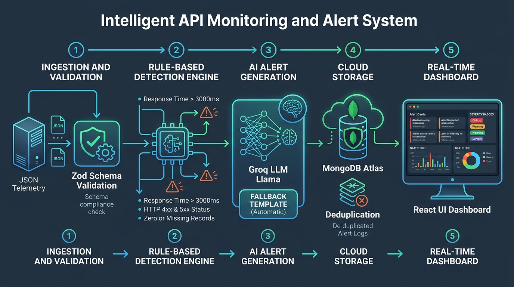

# Intelligent API Monitoring & Alert System

An automated, full-stack API health monitoring and anomaly detection platform that ingests telemetry, detects degraded or failed services, translates technical anomalies into human-readable alerts using the **Groq LLM (Llama 3.3)**, persists records in **MongoDB Atlas**, and surfaces them through a responsive **React** operations dashboard.

---

## 1. System Architecture



```
[ External Telemetry / Sample Data / Poller ]
                     │
                     ▼
             POST /monitor
                     │
                     ▼
           Validation (Zod)  ──[Invalid]──► 400 Bad Request
                     │
                     ▼
          Detection Engine (Pure Functions)
          • High Latency (>3000ms)
          • HTTP Status (5xx Critical, 4xx High)
          • Data Issues (0 or null records)
                     │
                     ├─[Healthy APIs]─► No action (saves compute)
                     ▼
          Groq LLM Alert Generation
          (with instant deterministic template fallback)
                     │
                     ▼
           MongoDB Atlas Storage
          • 10-minute De-duplication
          • Status tracking (Active / Resolved)
                     │
                     ├─► Optional Email Digest (Nodemailer)
                     ▼
           REST API & React Dashboard
          • Real-time Stats Cards
          • Live Poller ("Run Live Check")
          • Severity Filters & One-Click Resolve
```

---

## 2. Core Features

- **Automated Health Monitoring**: Ingests API latency (`response_time_ms`), HTTP status code (`status_code`), and record counts (`records_returned`).
- **Rule-Based Anomaly Detection**:
  - `HIGH_RESPONSE_TIME`: Triggers when latency $> 3000\text{ ms}$ (High severity if $> 6000\text{ ms}$, else Medium).
  - `FAILED_REQUEST`: Triggers on HTTP $\ge 400$ (Critical for $5\text{xx}$ server crashes, High for $4\text{xx}$ client errors).
  - `ZERO_RECORDS`: Triggers when an endpoint returns $0$ records on a $2\text{xx}$ success (High severity) or error (Medium).
  - `MISSING_DATA`: Triggers when record count is `null`, `undefined`, or negative (High severity).
- **AI-Powered Alert Summarization**: Converts raw telemetry into concise $1\text{–}2$ sentence operational alerts using **Groq LLM** (`llama-3.3-70b-versatile`).
- **Zero-Downtime Fallback**: If the LLM times out or is rate-limited, an instant deterministic fallback generator creates the alert with `aiGenerated: false`. The system never drops alerts.
- **Smart De-duplication**: Repeated anomalies for the same API within a 10-minute window increment an `occurrences` counter rather than cluttering the database or wasting AI tokens.
- **Interactive React Dashboard**:
  - Live summary stats (Total Active, Critical, High, Medium).
  - Search by API name, filter by severity, and toggle Active/Resolved.
  - **"Run Live Check"** button: Queries 6 real external endpoints (JSONPlaceholder, httpbin, Open-Meteo) and streams live results.
  - **"Load Sample Data"** button: Ingests the 7 required test cases in one click.
  - One-click **"Resolve"** button with optimistic UI updates.

---

## 3. Project Directory Structure

```
api-monitor/
├── README.md                      # Setup, documentation, and API reference
├── AI_Prompts.md                  # Complete log of prompts (for AI_Prompts.docx requirement)
├── INTERVIEW_TALKING_POINTS.md    # Step-by-step interview script and video guide
│
├── server/
│   ├── package.json
│   ├── .env.example               # Environment variables template
│   ├── data/
│   │   └── sample-input.json      # 7 test cases from the assignment
│   ├── scripts/
│   │   └── poller.js              # Standalone CLI poller
│   ├── tests/
│   │   ├── detector.test.js       # Unit tests for pure detection logic
│   │   └── aiAlert.test.js        # Unit tests for fallback alert generator
│   └── src/
│       ├── server.js              # Server bootstrap and graceful shutdown
│       ├── app.js                 # Express middleware and routing
│       ├── config/
│       │   ├── env.js             # Environment variables parser and validator
│       │   └── db.js              # MongoDB Atlas connection manager
│       ├── models/
│       │   └── Anomaly.js         # Mongoose schema with compound indexes
│       ├── services/
│       │   ├── detector.service.js# Pure anomaly detection rules
│       │   ├── aiAlert.service.js # Groq LLM integration + fallback builder
│       │   ├── monitor.service.js # Batch processor with concurrency & deduplication
│       │   ├── alerts.service.js  # Query, stats, and resolve operations
│       │   ├── poller.service.js  # Live external API checker
│       │   └── email.service.js   # Optional Nodemailer email dispatch
│       ├── controllers/
│       │   ├── monitor.controller.js
│       │   └── alerts.controller.js
│       ├── routes/
│       │   ├── index.js
│       │   ├── monitor.routes.js
│       │   └── alerts.routes.js
│       ├── middleware/
│       │   ├── validate.js        # Generic Zod validation middleware
│       │   ├── requestLogger.js   # Winston request logger
│       │   ├── notFound.js        # 404 handler
│       │   └── errorHandler.js    # Central error handler
│       └── utils/
│           ├── logger.js          # Winston console and file logger
│           ├── AppError.js        # Custom error class
│           └── asyncHandler.js    # Async wrapper
│
└── client/
    ├── package.json
    ├── vite.config.js
    ├── index.html
    └── src/
        ├── App.jsx                # Main dashboard page
        ├── styles.css             # Modern dark-mode styling
        ├── api/client.js          # Axios API client
        └── components/
            ├── Header.jsx         # Header with live action buttons
            ├── StatsCards.jsx     # Summary cards for severity counts
            ├── FilterBar.jsx      # Search, severity, and status filters
            ├── AlertCard.jsx      # Telemetry details, AI message, and resolve action
            ├── SeverityBadge.jsx  # Color-coded badge
            ├── EmptyState.jsx     # Operational state indicator
            ├── Loader.jsx         # Spinner loader
            └── ErrorBanner.jsx    # User error notice
```

---

## 4. Quick Start Guide

### Prerequisites
- **Node.js**: v20 or higher
- **MongoDB Atlas** account (free M0 cluster)
- **Groq Cloud API Key** (free at [console.groq.com](https://console.groq.com/keys))

---

### Step 1: Clone & Configure Server

```bash
cd server
npm install
```

Copy `.env.example` to `.env`:
```bash
cp .env.example .env
```

Open `server/.env` and insert your credentials:
```env
PORT=5000
MONGO_URI=mongodb+srv://<username>:<password>@<cluster>.mongodb.net/apimonitor?retryWrites=true&w=majority
GROQ_API_KEY=gsk_your_actual_groq_api_key_here
```

> **Note:** If you run without a `GROQ_API_KEY`, the server automatically uses the high-reliability fallback message generator.

---

### Step 2: Start the Server

```bash
# In /server directory
npm run dev
```

You should see:
```text
✅ MongoDB Atlas connected successfully
✅ HTTP Server listening at http://localhost:5000
```

---

### Step 3: Run Backend Tests

In a separate terminal:
```bash
cd server
npm test
```
All 11 unit tests will run and pass using Node's native test runner.

---

### Step 4: Start the React Dashboard

```bash
cd client
npm install
npm run dev
```

Open **`http://localhost:5173`** in your browser.

---

## 5. API Reference

### `POST /monitor`
Submit a batch of API health records.

**Request Body:**
```json
[
  { "api_name": "PatientDataAPI", "response_time_ms": 1200, "status_code": 200, "records_returned": 50 },
  { "api_name": "AppointmentAPI", "response_time_ms": 5500, "status_code": 500, "records_returned": 0 }
]
```

**Response (`201 Created`):**
```json
{
  "success": true,
  "received": 2,
  "healthy": 1,
  "anomaliesDetected": 1,
  "newAlerts": 1,
  "duplicates": 0,
  "anomalies": [
    {
      "apiName": "AppointmentAPI",
      "severity": "critical",
      "types": ["HIGH_RESPONSE_TIME", "FAILED_REQUEST", "ZERO_RECORDS"],
      "aiMessage": "AppointmentAPI failed with status 500 and returned 0 records. Possible outage or data issue.",
      "aiGenerated": true,
      "status": "active",
      "occurrences": 1
    }
  ]
}
```

---

### `POST /monitor/poll`
Runs live health checks across 6 external endpoints and analyzes them.

---

### `GET /alerts`
Fetch anomalies with optional query filters:
- `severity`: `critical` | `high` | `medium` | `low`
- `status`: `active` | `resolved` | `all` (default: `active`)
- `api_name`: partial case-insensitive search
- `page`: default 1
- `limit`: default 50

---

### `GET /alerts/stats`
Returns active counts grouped by severity and top failing APIs.

---

### `PATCH /alerts/:id/resolve`
Marks an active alert as resolved:
```bash
curl -X PATCH http://localhost:5000/alerts/67b9d9f582b123456789abcd/resolve
```

---

## 6. Testing with cURL

You can test the entire pipeline using cURL and the sample data:

```bash
curl -X POST http://localhost:5000/monitor \
  -H "Content-Type: application/json" \
  -d @data/sample-input.json
```

---

## 7. Key Architecture Decisions for Technical Interviews

1. **Pure Function Detector (`detector.service.js`)**:
   Zero dependencies or I/O. Extremely fast, 100% deterministic, and can be unit-tested in under 10ms.
2. **Groq LPU Acceleration (`aiAlert.service.js`)**:
   Provides sub-second LLM inference speed, ideal for real-time alerting without adding noticeable latency to the pipeline.
3. **Guaranteed Uptime Fallback**:
   Network or LLM outages never break the monitoring system. If Groq fails, the system immediately switches to a deterministic alert generator.
4. **Intelligent De-duplication**:
   Avoids alert spam during outages by grouping identical errors within a 10-minute window into a single alert document with an incremented counter.
5. **Controlled Concurrency**:
   `p-limit` prevents rate-limit errors when processing large batches of anomalous endpoints.
